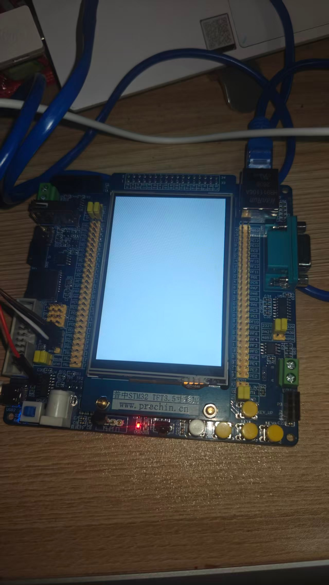

# project-f407-daq

普中战神F407 数据采集系统项目仓库（2028届嵌入式求职 · 阶段1起点）
配套：《嵌入式学习计划_2026-10修订版》｜ 主线：普中HAL库版教程

## W1 D1 首灯（2026-10-29）

- 代码：`User/main.c` 寄存器三件套 —— `RCC_AHB1ENR|=1<<5` 合GPIOF空开 → `GPIOF_MODER=1<<(2*9)` 给PF9发输出工作证 → `GPIOF_BSRR` 按钮式翻转（DS0红灯，低电平点亮）
- 编译：Keil5 MDK-Community + STM32F4xx_DFP 2.14.0，`0 Error(s), 0 Warning(s)`，Code=204
- 链路：ST-Link V2(WinUSB) SWD@1MHz + 板USB2侧口 CH340=COM3

### 踩坑日志（首灯四坑）
1. **白线插GND**：SWDIO进GND槽 → "Cannot enter Debug Mode"；核线必须逐色对丝印，"我以为"不算核对；
2. **Keil误选CMSIS-DAP**：Debug页右下拉=选司机，克隆ST-Link要选 ST-Link Debugger；
3. **SWD 4MHz失败**：杜邦长线信号完整性不够，降1MHz即稳（CubeProgrammer 950kHz旁证）；
4. **烧录后需复位**：Flash写完内核不会自动换节目；勾 Flash Download→Reset and Run 一劳永逸。另：烧录半途失败会留下"半擦Flash"假死态，现象=白屏+寄存器全0，对策=重烧。

### 接线档案
棕=ST-Link pin2(SWCLK)→J4 CLK(最右)；白=pin4(SWDIO)→J4 DIO(左2)；黑=pin5(GND)→J4 GND(左3)；J4 3V3空；板子自供电。

## TODO
- [ ] W2：按键消抖+EXTI + fp状态机微课
- [ ] 延时改SysTick；LED引脚宏化（PF9魔法数字清零）
